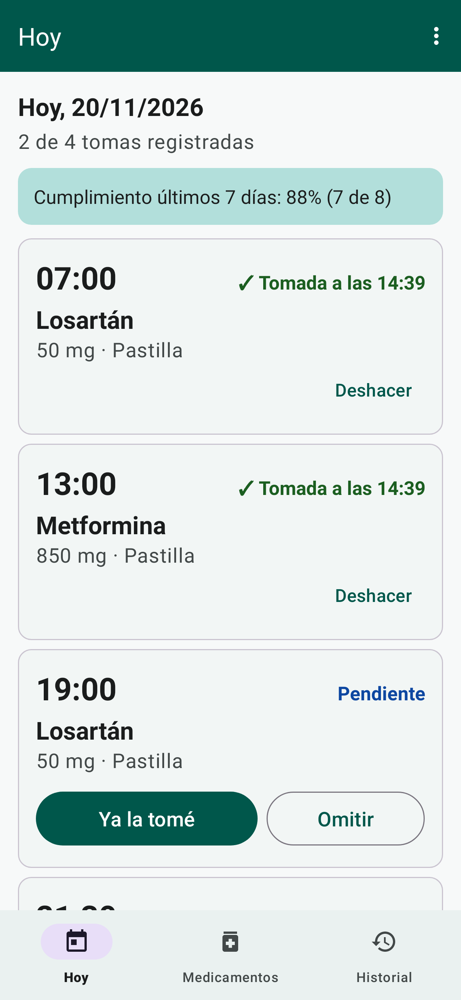
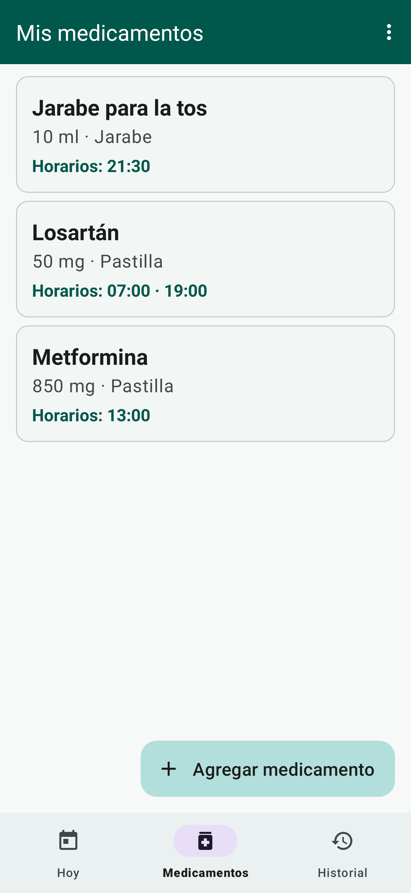
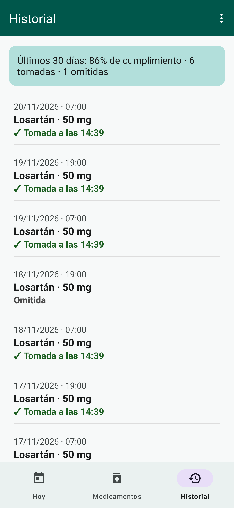
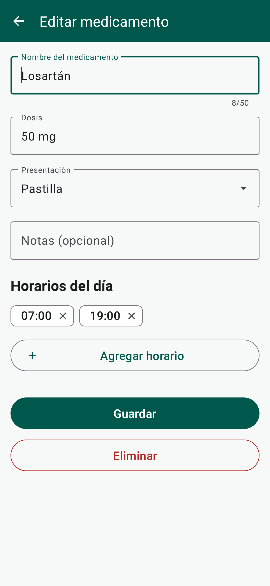
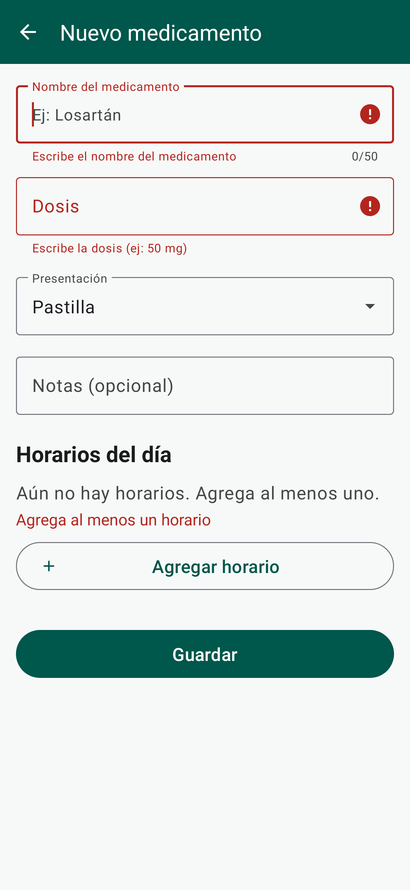
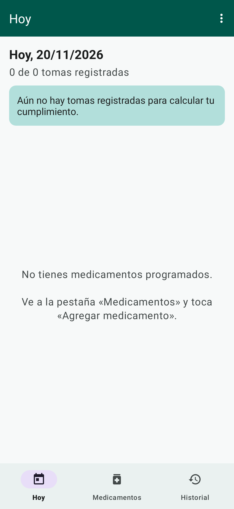
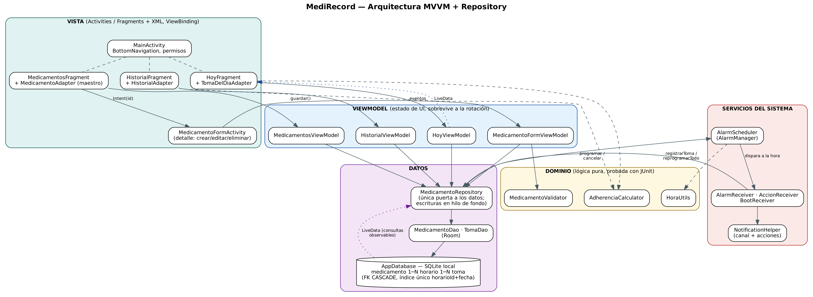

# MediRecord

**Recordatorio de medicamentos para Android, pensado para adultos mayores y sus cuidadores.**


Proyecto final de **Desarrollo de Aplicaciones Móviles (Computación Móvil)**, Universidad Manuela Beltrán, 2026-2.

---

## Problematica

Las personas que toman varios medicamentos al día, en especial adultos mayores con enfermedades crónicas, **olvidan dosis o las repiten** porque no recuerdan si ya las tomaron. Una alarma común del celular no dice qué medicamento toca ni guarda un registro.

## Solución

MediRecord avisa a la hora de cada toma, deja responder desde la misma notificación y guarda un historial que muestra cuánto se ha cumplido el tratamiento. Funciona **100 % sin internet**.

## Capturas

| Hoy | Mis medicamentos | Historial |
|:---:|:---:|:---:|
|  |  |  |

| Editar medicamento | Validaciones | Estado vacío |
|:---:|:---:|:---:|
|  |  |  |

> Capturas generadas automáticamente por las pruebas de interfaz (Robolectric, pantalla de 411×891 dp).

## Funcionalidades

- **Gestión de medicamentos (CRUD):** nombre, dosis, presentación, notas y de 1 a 8 horarios por día.
- **Pantalla Hoy:** tomas del día ordenadas por hora con su estado (pendiente, atrasada, tomada u omitida) y botones *Ya la tomé*, *Omitir* y *Deshacer*.
- **Recordatorios:** notificación a la hora programada con las acciones *Ya la tomé* y *Posponer 10 min*. Las alarmas se reprograman al reiniciar el celular o cambiar la hora.
- **Historial y cumplimiento:** porcentaje de los últimos 7 y 30 días.
- **Validaciones:** campos obligatorios, horarios repetidos y nombre duplicado (sin importar tildes ni mayúsculas).
- **Accesibilidad:**
  - textos de 16 a 28 sp y botones de 56 dp de alto;
  - colores con contraste WCAG AA, siempre acompañados de texto;
  - descripciones para TalkBack.
- **Idiomas:** 🇨🇴 español (por defecto) y 🇺🇸 inglés.

## Arquitectura

**MVVM + Repository**, con una capa de dominio de lógica pura:



| Capa | Responsabilidad |
|---|---|
| **Vista** (`ui/`) | Activities, Fragments y Adapters. Solo muestran datos y envían eventos. |
| **ViewModel** | Estado de cada pantalla. Sobrevive a la rotación y expone `LiveData`. |
| **Dominio** (`domain/`) | Validaciones, cálculo de horas y de cumplimiento, sin dependencias de Android. |
| **Datos** (`data/`) | `MedicamentoRepository`, la única puerta a los datos (escribe en un hilo de fondo), más DAOs de Room y SQLite. |
| **Servicios** (`alarm/`) | `AlarmManager`, receivers y notificaciones. |

**Modelo de datos:** `medicamento` 1─N `horario` 1─N `toma`
- Las claves foráneas usan `CASCADE`.
- El índice único `(horarioId, fecha)` impide registrar la misma toma dos veces.

<details>
<summary>Estructura del código</summary>

```
app/src/main/java/co/edu/umb/medirecord/
├── MediRecordApp.java
├── alarm/        AlarmScheduler, AlarmReceiver, AccionReceiver, BootReceiver, NotificationHelper
├── data/         AppDatabase, MedicamentoRepository
│   ├── dao/      MedicamentoDao, TomaDao
│   ├── entity/   Medicamento, Horario, Toma
│   └── model/    MedicamentoConHorarios, TomaDelDia, RegistroHistorial, ResumenAdherencia
├── domain/       MedicamentoValidator, AdherenciaCalculator, HoraUtils
└── ui/           MainActivity
    ├── hoy/            HoyFragment, HoyViewModel, TomaDelDiaAdapter
    ├── medicamentos/   MedicamentosFragment, MedicamentoFormActivity, ViewModels, Adapter
    └── historial/      HistorialFragment, HistorialViewModel, HistorialAdapter
```
</details>

## Tecnologías

| | |
|---|---|
| Lenguaje | Java 17 |
| SDK | compileSdk 34 · minSdk 26 (Android 8.0) |
| Build | Gradle 8.14.3 · Android Gradle Plugin 8.7.3 |
| Persistencia | Room 2.6.1 (SQLite) |
| UI | Material Components 1.12 (Material 3) · RecyclerView + DiffUtil · ViewBinding |
| Arquitectura | AndroidX Lifecycle (ViewModel, LiveData) 2.7 |
| Pruebas | JUnit 4.13.2 · Robolectric 4.13 |

## Cómo ejecutar

**Con Android Studio**
1. Clonar el repositorio:
   ```bash
   git clone https://github.com/jscarreno/MediRecord.git
   ```
2. Abrir la carpeta en Android Studio (Ladybug 2024.2 o posterior) y esperar el *Gradle sync*.
3. Ejecutar la configuración **app** en un emulador o en un celular con Android 8.0 o superior.

**Con el APK**
```bash
adb install MediRecord-v1.0.0-debug.apk
```

**Probar un recordatorio**
1. Agregar un medicamento con un horario 1–2 minutos después de la hora actual.
2. En Android 12 o superior, activar *Menú ⋮ → Activar recordatorios puntuales* para que el aviso llegue a la hora exacta.

> La app no tiene usuarios ni contraseñas.

## Pruebas

```bash
./gradlew testDebugUnitTest
```

| Clase | Qué valida | Pruebas |
|---|---|:---:|
| `MedicamentoValidatorTest` | Reglas del formulario | 10 |
| `HoraUtilsTest` | Cálculo del próximo aviso (incluye cambio de día y de mes) | 8 |
| `AdherenciaCalculatorTest` | Porcentaje de cumplimiento | 4 |
| `PersistenciaTest` | Room: CRUD, borrado en cascada, duplicados, alarmas programadas | 8 |
| `PantallasTest` | Interfaz: flujos, errores, rotación y capturas de pantalla | 6 |
| **Total** | | **36** |

El reporte HTML queda en `app/build/reports/tests/testDebugUnitTest/index.html`. Hay una copia en `docs/reporte-pruebas/`.

### Medir rendimiento en el dispositivo
La app registra tiempos en Logcat con la etiqueta **`MediRecordPerf`**:

```
pantallaHoy primerosDatos ms=…
guardarMedicamento ms=…
registrarToma ms=…
reprogramarTodo ms=…
```

Para CPU y memoria, usar **Android Studio → Profiler**.

## Limitaciones conocidas

- No hay sincronización en la nube ni una cuenta para el cuidador.
- Al eliminar un medicamento también se borra su historial.
- La presentación (Pastilla, Jarabe…) se guarda en el idioma activo.
- Sin el permiso de alarmas exactas (Android 12+), el aviso puede llegar hasta 1 minuto tarde.

## Equipo 

- Johan Santiago Carreño Navarro
- Oscar Andrés Ortiz Mora

Docente: Robert Osorio Torres · Universidad Manuela Beltrán · 2026-2


